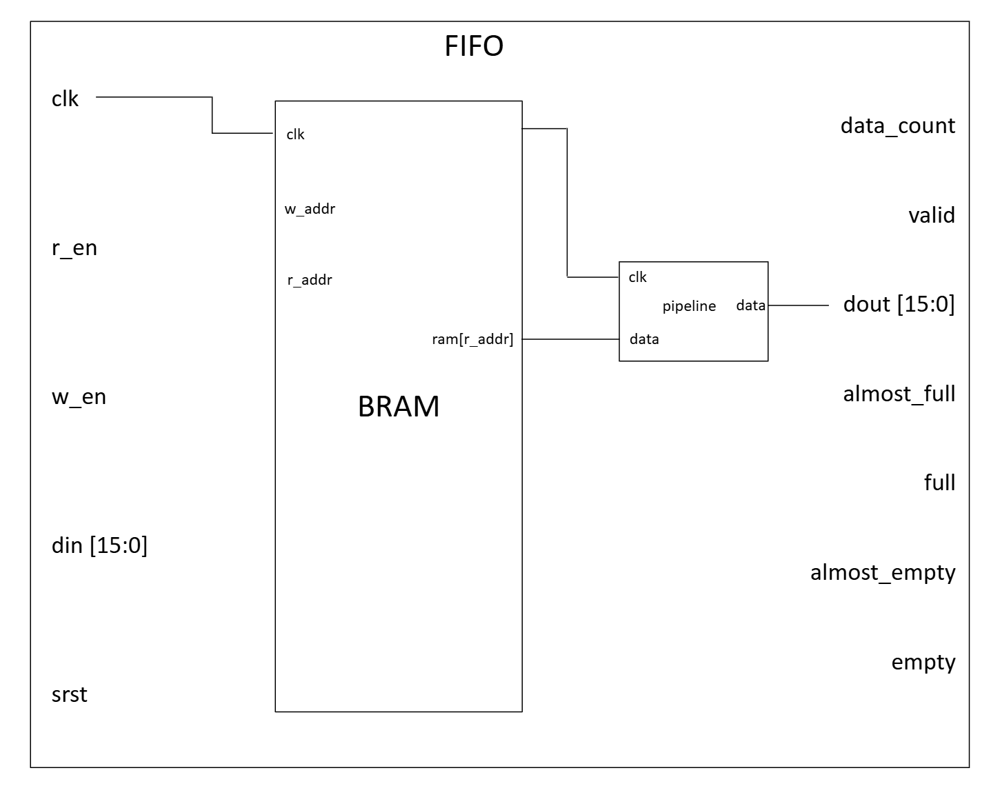

# Lab 3 - BRAM-FIFO

## Overview
This lab assignment involves the design of a FIFO memory unit which utilizes Block RAM (BRAM).  With BRAM, the system clock controls both write and read access by stepping the respective pointers through each address.  The appropriate flags are also implemented at the output to track the status of the BRAM such as when it is about to reach capacity and when it is full.  Similarly, the availability of memory will be tracked via "empty" flags.  A "valid" flag at the output will represent whether a successful read has occurred (i.e. read is enabled and there is something to read from memory -> empty flag is low).  Lastly, a data-read pipeline will be included such that the referenced data will only appear at the output of the FIFO block once a specified number of clock cycles have elapsed.  For proper state propagation of the data, the valid flag shall also propagate through the pipeline.

## Design Summary

* Note: For diagram simplification, data I/O for the pipeline block includes both the reference data and the valid flag

## Verification and Results

## Known Issues and Limitations

## References

